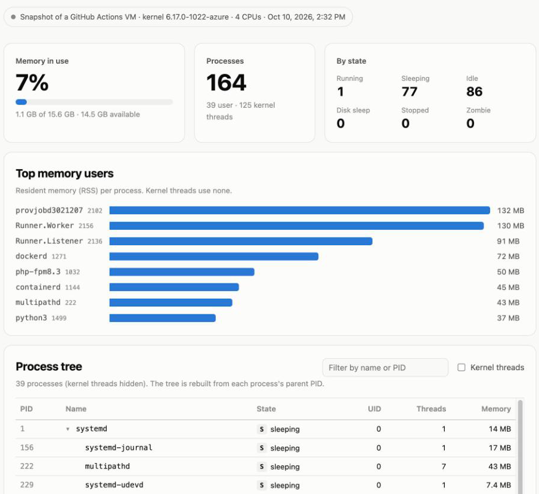

# Linux Kernel Monitor

[](https://github.com/andreanicte02/linux-kernel-monitor/actions/workflows/ci.yml)
[](https://andreanicte02.github.io/linux-kernel-monitor/)

*[Leer en español](#en-español)*

> **Created by [Tikiram Samaneb Ruiz Manuel](https://github.com/tikiram)** · rescued in 2026 by [@andreanicte02](https://github.com/andreanicte02)

A **Linux kernel module written in C** that walks the kernel's own process list and memory
counters and publishes them as JSON files in `/proc`, plus a small **Go** server and a web
dashboard that read them.

**▶ Dashboard: <https://andreanicte02.github.io/linux-kernel-monitor/>** — a real snapshot of a
GitHub Actions VM, taken through this module on every push.

[](https://andreanicte02.github.io/linux-kernel-monitor/)

## How it works

```
 kernel space                         user space
┌──────────────────────────┐        ┌─────────────────┐     ┌──────────────────────┐
│ kmon.ko                  │ writes │ /proc/kmon_procs │ ──► │ kmon serve (Go)      │ ──► dashboard
│ for_each_process (RCU)   │ ─────► │ /proc/kmon_mem   │     │ GET /api/snapshot    │
│ si_meminfo, task state   │        │ /proc/kmon_states│     └──────────────────────┘
└──────────────────────────┘        └─────────────────┘
```

| `/proc` file | Contents |
|---|---|
| `kmon_procs` | Every process: PID, parent PID, name, state (`R`, `S`, `D`, `Z`, `I`…), UID, threads, resident memory |
| `kmon_mem` | Total, free, available, buffers and shared memory, in KiB |
| `kmon_states` | Process count per state |

```console
$ cat /proc/kmon_states
{"running":1,"sleeping":77,"disk_sleep":0,"stopped":0,"zombie":0,"idle":86,"other":0,"total":164}
```

## Run it

On any Linux machine with kernel headers (`sudo apt install linux-headers-$(uname -r)` on Ubuntu/Debian):

```sh
make -C module load          # build kmon.ko for your kernel and insmod it
cat /proc/kmon_procs         # raw JSON straight from the kernel

go run ./cmd/kmon serve      # live dashboard on http://localhost:8080
go run ./cmd/kmon snapshot   # one-off JSON snapshot

make -C module unload
```

## Tested on every push

GitHub Actions doesn't just compile the module — it **loads it into a real kernel**
(`scripts/test-module.sh`):

1. Builds against the runner's kernel headers and fails on any compiler warning in the module.
2. `insmod`, then validates all three `/proc` files as JSON.
3. Starts a process whose kernel name contains `"` and `\` and checks it round-trips intact —
   the escaping that keeps the JSON valid.
4. Reads the process list 200 times while processes are being created and destroyed.
5. Cross-checks memory totals against `/proc/meminfo` and state counts against the process list.
6. Takes the dashboard snapshot, `rmmod`, and fails if `dmesg` shows any `BUG`, `Oops` or `WARNING`.

The module also compiles cleanly against Ubuntu's 5.4, 5.15 and 6.8 kernel headers; GitHub's
runners load it on 6.17.

## What changed from the 2020 version

The original was written in 2020 for Operating Systems 2 at USAC. The 2026 rewrite keeps the
idea and fixes what time (and code review) found:

| 2020 | 2026 |
|---|---|
| Three modules using `file_operations`, which no longer compiles after Linux 5.6 | One module using `proc_create_single()`, which builds on old and new kernels |
| Read `task->state` directly (renamed in 5.14) and compared raw numbers like `260` | `task_state_to_char()`, the same letters `ps` shows |
| Process names printed into JSON unescaped — a `"` in a name broke the output | Every name is escaped; CI proves it with a deliberately weird name |
| Children counted twice in the state totals | Each process counted once |
| Memory reported in pages but labelled as MB | Converted with `mem_unit`; checked against `/proc/meminfo` |
| `GET /kill/{pid}` killed any process, guarded only by an `admin/admin` check in the browser | API is read-only |
| React app build output committed to the repo | Small static dashboard; tree, search and live refresh |

## Layout

```
module/          kernel module (C): kmon_main.c, kmon_procs.c, kmon_mem.c, kmon_states.c
kmon/            Go package that reads /proc/kmon_* (+ tests with fixture files)
cmd/kmon/        `kmon serve` and `kmon snapshot`
web/             dashboard (static; live when served by kmon, snapshot on GitHub Pages)
scripts/         test-module.sh — build, load, verify, snapshot, unload
```

## Author

**Tikiram Samaneb Ruiz Manuel** ([@tikiram](https://github.com/tikiram)) — author of the project.

Rescued and updated in 2026 by [@andreanicte02](https://github.com/andreanicte02).

---

## En español

> **Creado por [Tikiram Samaneb Ruiz Manuel](https://github.com/tikiram)** · rescatado en 2026 por [@andreanicte02](https://github.com/andreanicte02)

**Linux Kernel Monitor** es un **módulo del kernel de Linux escrito en C** que recorre la
lista de procesos del kernel y sus contadores de memoria, y los publica como JSON en `/proc`.
Un servidor en **Go** los convierte en una API y un dashboard web los muestra.

- **Dashboard en vivo:** <https://andreanicte02.github.io/linux-kernel-monitor/>. Es una foto
  real de una máquina virtual de GitHub Actions, tomada con este módulo en cada push.
- **Probado de verdad:** en cada push, GitHub Actions compila el módulo, lo carga en el kernel
  con `insmod`, valida su salida (incluso con nombres de procesos "raros"), lo estresa y lo
  descarga sin errores.

Empezó en 2020 como proyecto de Sistemas Operativos 2 en la USAC. Todo el crédito es de
**Tikiram Samaneb Ruiz Manuel** ([@tikiram](https://github.com/tikiram)).

## License

[GPL-2.0](LICENSE), as required for code that runs inside the Linux kernel.
